<picture>
  <source media="(prefers-color-scheme: dark)" srcset="https://raw.githubusercontent.com/saintcoder0/saintcoder0/gitascii/profiles/default/dark.svg">
  <source media="(prefers-color-scheme: light)" srcset="https://raw.githubusercontent.com/saintcoder0/saintcoder0/gitascii/profiles/default/light.svg">
  
</picture>
